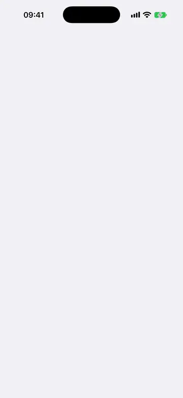
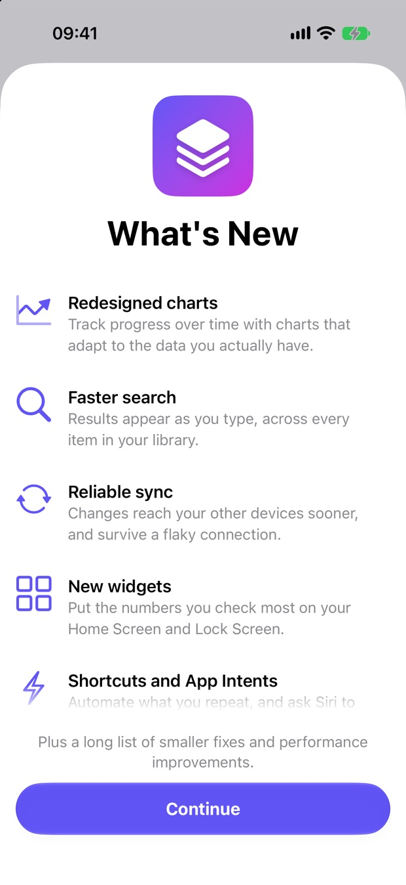
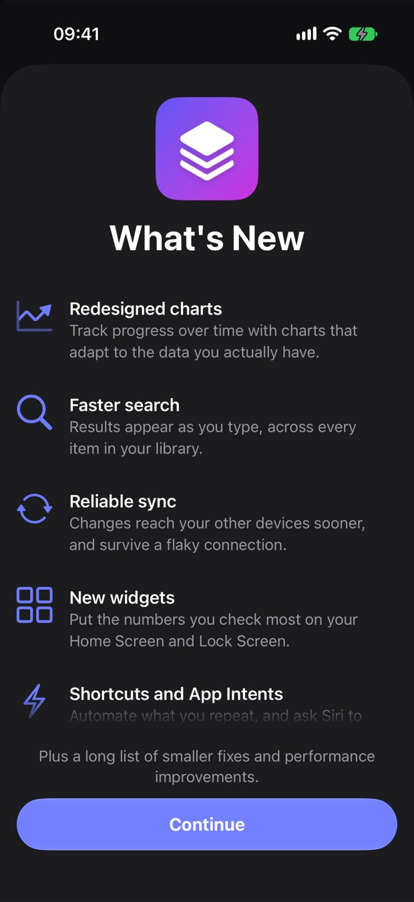
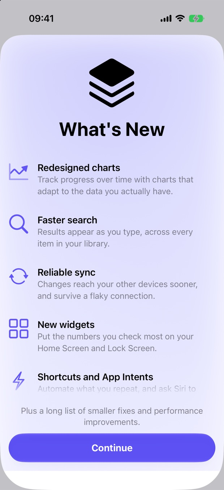
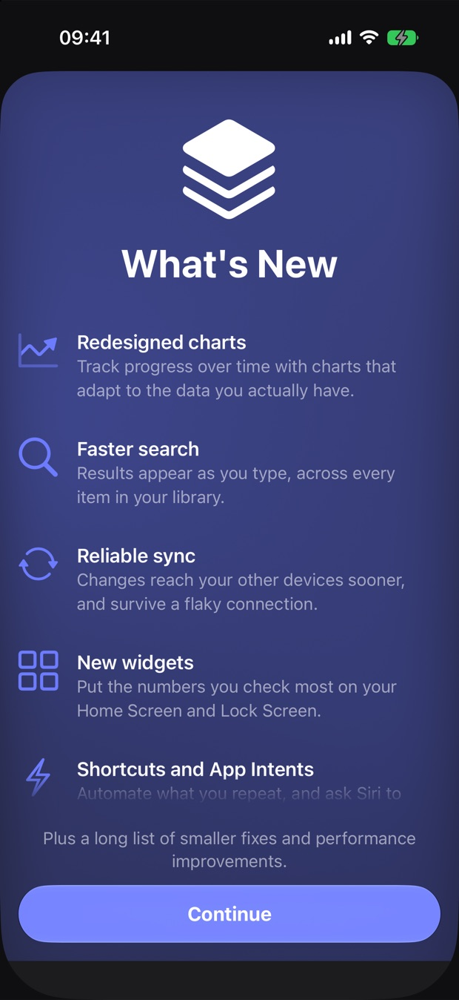
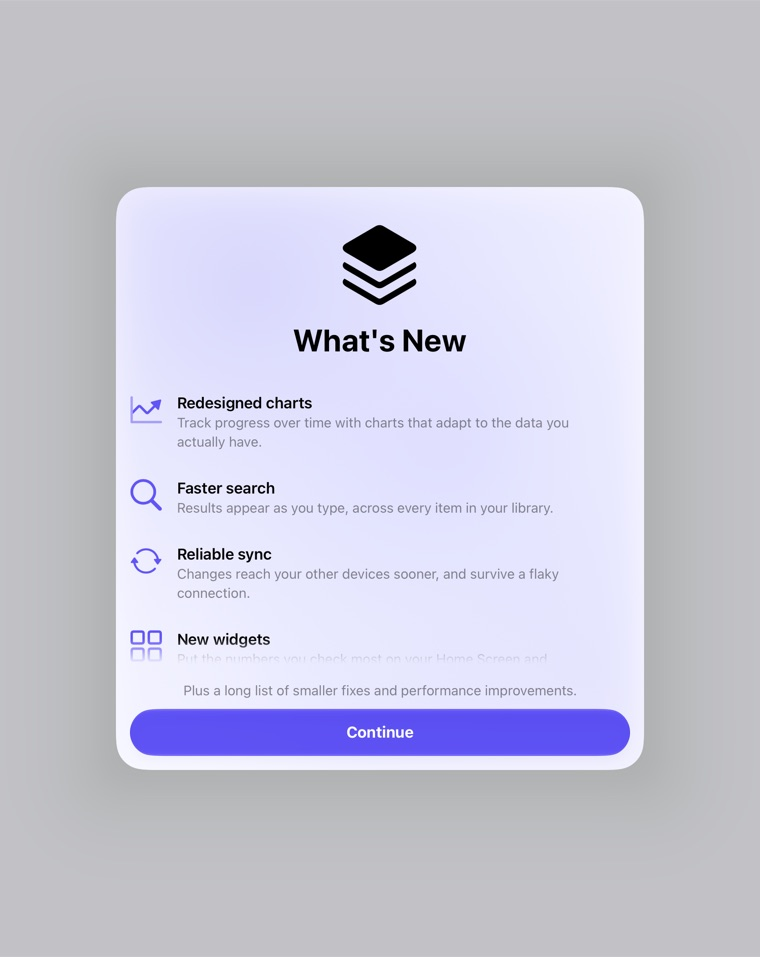
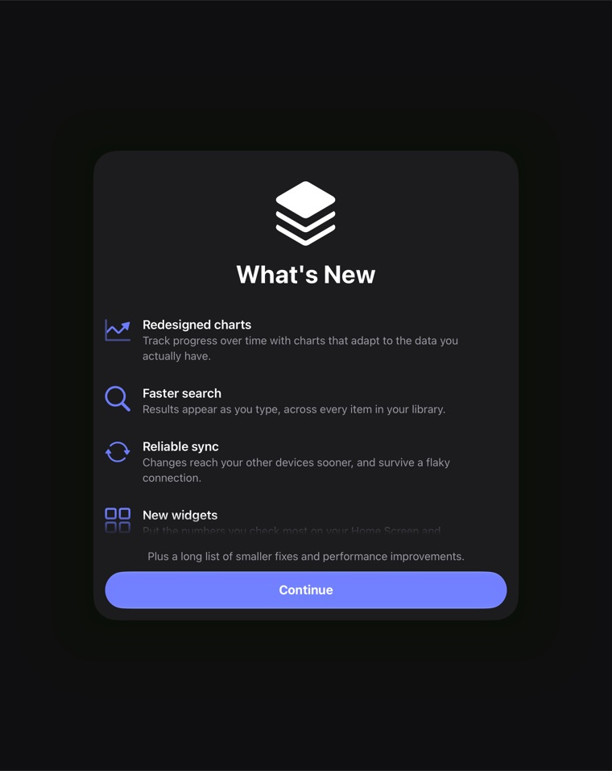
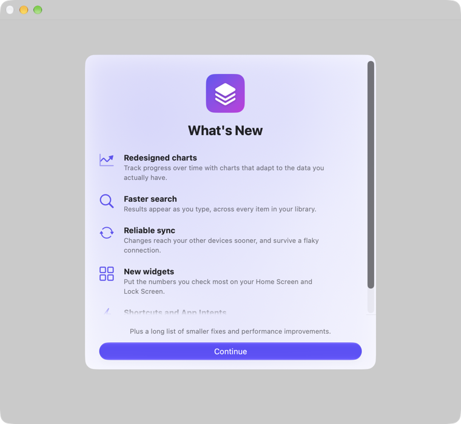
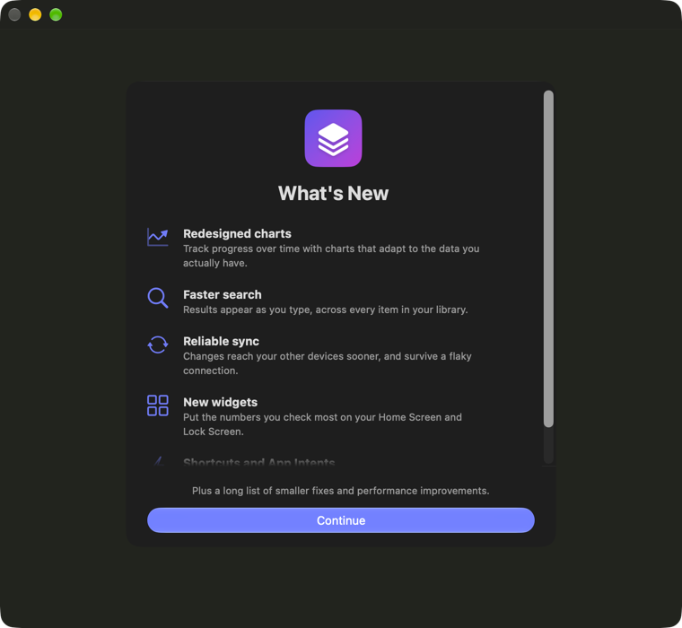

# ReleaseKit

[](https://github.com/hksw-io/releasekit/actions/workflows/ci.yml)

A reusable SwiftUI "What's New" sheet for iOS and macOS apps in the HK Softworks portfolio.

## Preview

<p>
  
</p>

The sheet presenting on iPhone with `.animatedGradient()`. Rows reveal in sequence while the gradient drifts behind them.

The default `.system` background on iPhone. Rows fade out where they meet the pinned footer, and the button spans it:

<p>
  
  
</p>

`.animatedGradient()`, taking its brand color from `ReleaseStyle.tint`. It adapts its tones per color scheme and holds still under Reduce Motion:

<p>
  
  
</p>

On iPad the same sheet presents as a centered card. Its size comes from the presentation, and ReleaseKit caps the content column at 560pt:

<p>
  
  
</p>

On macOS it is a resizable window with the platform's overlay scroller, and Escape runs `onContinue`:

<p>
  
  
</p>

## Requirements

- iOS 26+ / macOS 26+
- Swift 6.2+

## Installation

```swift
.package(url: "https://github.com/hksw-io/releasekit.git", exact: "3.2.0")
```

Or in Xcode: **File > Add Package Dependencies**, enter the URL above, and choose **Exact Version** `3.2.0`.

See [CHANGELOG.md](CHANGELOG.md) for what changed between releases. A minor release may contain a
breaking change, marked **Breaking** there, so pin an exact version.

## Usage

Implement `ReleaseContent` with your app's strings and icon, then present the view. Only `title`, `features`, and `buttonText` are required — `appIcon` and `notice` default to `nil`:

```swift
import SwiftUI
import ReleaseKit

struct MyRelease: ReleaseContent {
    var appIcon: Image? { Image("AppIconImage") }
    var title: Text { Text("What's New in MyApp") }
    var features: [ReleaseFeature] {
        [
            ReleaseFeature(
                id: "new-charts",
                systemImage: "chart.line.uptrend.xyaxis.circle",
                label: "New Charts",
                description: "Track your progress with redesigned charts."),
        ]
    }
    var notice: ReleaseNotice? {
        ReleaseNotice("Plus many other improvements.")
    }
    var buttonText: Text { Text("Continue") }
}

struct RootView: View {
    @State private var isShowing = false

    var body: some View {
        ContentView()
            .sheet(isPresented: $isShowing) {
                ReleaseView(content: MyRelease()) {
                    isShowing = false
                }
            }
    }
}
```

## Backgrounds

The default background is the opaque system background color (`systemBackground` on iOS, `windowBackgroundColor` on macOS). Use `releaseBackground(_:)` when an app needs a more branded release note experience:

```swift
ReleaseView(content: MyRelease()) {
    isShowing = false
}
.releaseBackground(.animatedGradient())
.releaseStyle(ReleaseStyle(tint: .indigo))
```

`releaseBackground(_:)` and `releaseStyle(_:)` are methods on `ReleaseView` that return a `ReleaseView`, not general view modifiers. Apply them before any other modifier, such as `presentationDetents(_:)`.

Built-in options:

- `.system` — the default platform background.
- `.softGradient` / `.softGradient(brand:)` — a restrained brand-derived background tuned for readable content.
- `.animatedGradient(brand:)` — an opt-in smooth full-surface animated gradient. It uses the style tint by default, adapts its tones for light and dark mode, automatically becomes static when Reduce Motion is enabled, and pauses while its window is inactive.
- `.custom { context in ... }` — a fully custom SwiftUI background, including a plain `LinearGradient` of your own colors. Use `context.reduceMotion`, `context.reduceTransparency`, `context.colorSchemeContrast`, `context.brandColor`, and `context.colorScheme` to keep custom backgrounds consistent and accessible.

Every background fills the whole sheet, including `.system`: it runs behind the pinned footer and button and on past the safe area to the sheet's edges. macOS shows its normal overlay scroller, which is how a Mac signals that a list continues; iOS hides the indicator and lets the content fade out at the footer instead.

`ReleaseStyle.tint` is the default brand color for `.softGradient` and `.animatedGradient()`, falling back to blue when no tint is set. The supporting tones are that same color washed toward the platform surface, so the field reads as one color family rather than as unrelated hues — and because the surface is light in light mode and dark in dark mode, the same wash lifts the tones in one and deepens them in the other.

Pass `brand:` when the background should use a different brand color from the controls:

```swift
ReleaseView(content: MyRelease()) {
    isShowing = false
}
.releaseBackground(.animatedGradient(brand: .pink))
```

For exact colors of your own, draw them in a `.custom` background.

The animated gradient's travel, speed, and contrast are fixed. Reduce Motion holds it still, and it stops drawing while its window is inactive, such as a Mac sheet whose app is behind another; there is no per-app intensity to set.

Reduce Transparency or Increase Contrast replaces either built-in gradient with the opaque
system surface.

ReleaseKit keeps the footer pinned, sized to its own content. Rows fade out over a short band where they meet it, so the background carries through unbroken and a footer running to several lines never has content showing through it. The footer reserves no more space than it uses.

## Styling

Use `releaseStyle(_:)` to set the sheet's tint while keeping the library's layout, typography, and motion:

```swift
ReleaseView(content: MyRelease()) {
    isShowing = false
}
.releaseStyle(ReleaseStyle(tint: .indigo))
```

`tint` colors the prominent button and the feature icons, and is the default brand color for the gradient backgrounds. Left `nil`, the sheet keeps the tint it inherits. Text uses the system's primary and secondary colors, and the button label uses the system's prominent-button label color, which already adapts to your tint, to light and dark mode, and to Increase Contrast. `ReleaseBackground` controls the surface behind the content.

## Platform behavior

The sheet is one API with two deliberately different presentations. Apart from interactive dismissal, you do not configure this; it follows the platform.

| | iOS | macOS |
|---|---|---|
| Return | Activates the button | Activates the button |
| Escape | — | Runs the view's `onContinue` |
| Swipe to dismiss | On; off with `allowsInteractiveDismissal: false` | — |
| Scroll indicator | Hidden | Normal overlay scroller |
| Sheet size | Set by the presentation | 560×520 ideal, 480×420 floor |
| Reveal motion | 38pt travel | 20pt travel, leads sooner |

Under Reduce Motion the rows appear without the reveal.

At accessibility text sizes the sheet gives the room to the words: the app icon, which is decorative, is not shown, and the notice moves out of the pinned footer to the end of the scrolling rows, so only the button stays pinned. Apps do not need to strip either themselves.

The footer button is a full-width prominent capsule on both platforms. The sheet is a single-action surface, so the button reads as the end of the content rather than as a Mac sheet's bottom-trailing default button. Both platforms use the system prominent button style, so press, hover, focus, and Increase Contrast behavior come from the platform rather than from anything this package draws.

On macOS, Escape calls the view's `onContinue` closure, the same one the button calls, instead of dismissing the sheet natively. For where to record that the release was seen, see [Version tracking](#version-tracking).

Text in the title and feature rows is selectable, which Mac users expect of a window they may want to copy out of.

## Features and localization

Every `ReleaseFeature` requires a stable `id`. Stable IDs let SwiftUI preserve row identity when features are inserted, removed, or reordered. Because conformers usually expose `features` as a computed property, an ID derived per evaluation — a fresh `UUID()`, say — would re-create every row on each pass and replay the entrance animation.

`ReleaseFeature` and `ReleaseNotice` each have a `Text` initializer and a `LocalizedStringResource` one. Use `ReleaseFeature(id:image:label:description:)` for an asset-catalog icon or pre-styled `Text`; `ReleaseFeature(id:systemImage:label:description:)` takes an SF Symbol name and localized strings. Localized values resolve against your app's bundle, so ReleaseKit ships no strings of its own and never localizes on your behalf. That is also why `buttonText` has no default.

The content types are `Equatable` and `Sendable`, and `ReleaseContent` refines `Sendable`.

## Version tracking

`ReleaseVersionTracker` persists the last-shown version in `UserDefaults` and decides whether to present the sheet on launch:

```swift
let tracker = ReleaseVersionTracker(
    keyPrefix: "com.example.myapp",
    currentVersion: "1.2.0")

if tracker.shouldShowRelease() {
    // present ReleaseView
}

// after dismiss:
tracker.markAsShown()
```

The first launch after install is treated as "not new" — users see the sheet only on subsequent version upgrades. `shouldShowRelease()` is not a pure query: on that first launch it writes both tracking keys before returning `false`. Every later call only reads. Specifically, the first call for a given `keyPrefix` and defaults store counts as the first launch, so an app adopting ReleaseKit in an update, changing `keyPrefix`, or moving to an App Group suite skips the sheet for existing users on that version.

Versions are compared for equality, not order, so `currentVersion` can be any string your app treats as its release identity. A rollback to an older version also shows the sheet.

`keyPrefix` namespaces the two keys the tracker writes, `<keyPrefix>.release.lastShownVersion` and `<keyPrefix>.hasLaunchedBefore`, so trackers with different prefixes never observe each other's state. Don't read or write either key from your own code; the tracker exposes the first-launch state instead:

```swift
// A pure read: false on a fresh install until the first shouldShowRelease() or recordFirstLaunch().
if !tracker.hasLaunchedBefore {
    // show a welcome instead
}

// Adopting an installation that predates the tracker: record the version it last ran,
// so the running version counts as new. Does nothing once a launch has been recorded.
ReleaseVersionTracker(keyPrefix: "com.example.myapp", currentVersion: "1.1").recordFirstLaunch()
```

`userDefaults` defaults to `.standard`. Pass a suite to share state across an App Group or to isolate tests:

```swift
let tracker = ReleaseVersionTracker(
    userDefaults: UserDefaults(suiteName: "group.com.example.myapp")!,
    keyPrefix: "com.example.myapp",
    currentVersion: "1.2.0")
```

The package bundles `PrivacyInfo.xcprivacy` for app-local (`CA92.1`) and same-App-Group
(`1C8F.1`) UserDefaults storage. Pass only your app's defaults or an entitled App Group suite,
and use an app-specific prefix. ReleaseKit does not collect data or perform tracking. Preserve
the Swift package resource bundle when embedding the library and verify the manifest in your archive.

`ReleaseView`'s `onContinue` runs for the button and the Mac Escape shortcut, and your code
closes the presentation there; it does not run when the sheet closes any other way. Native
dismissal gestures are allowed by default, so record acknowledgement in the presentation's own
`onDismiss`, which runs after every dismissal:

```swift
.sheet(isPresented: $isShowing, onDismiss: tracker.markAsShown) {
    ReleaseView(content: MyRelease()) {
        isShowing = false
    }
}
```

With the presentation callback recording acknowledgement, the button closure only needs to set
`isShowing = false`. If you record it in `onContinue` instead, pass
`allowsInteractiveDismissal: false`; otherwise a swipe leaves the release unacknowledged and
the sheet comes back on the next launch.

## Fitting the sheet to its content

By default the presentation picks the sheet's height: full height on iPhone, a fixed form on iPad, a fixed window on Mac. `releaseFittedSheet()` sizes it to the release content instead, so a few features get a short sheet and a longer list gets the room it needs without scrolling:

```swift
.sheet(isPresented: $isShowing, onDismiss: tracker.markAsShown) {
    ReleaseView(content: MyRelease()) {
        isShowing = false
    }
    .releaseBackground(.softGradient)
    .releaseFittedSheet()
}
```

It is a general view modifier, so apply it after `releaseBackground(_:)` and `releaseStyle(_:)`. The height is the scrolling content plus the pinned footer. On iPhone it becomes the sheet's only detent, on iPad and Mac the sheet fits it, and content taller than the screen still gets a full-height sheet and scrolls. On Mac the sheet never goes below its 420pt floor.

The same height is offered as the view's ideal height, so a `UIHostingController` or `NSHostingController` with `sizingOptions = .preferredContentSize` fits too. GreetKit 3.2.0 ships the same modifier as `greetFittedSheet()`.

## Local development

Run the package tests from the package root:

```sh
swift test
```

The README media was captured from the iOS 27.2 Simulator (iPhone 17 Pro, iPad Pro 11-inch)
and a macOS window.

## License

MIT. See [LICENSE](LICENSE).
