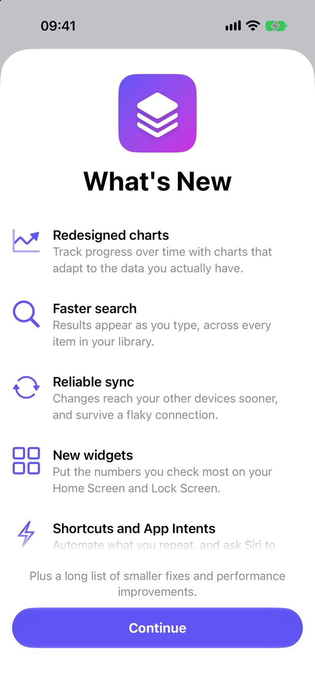
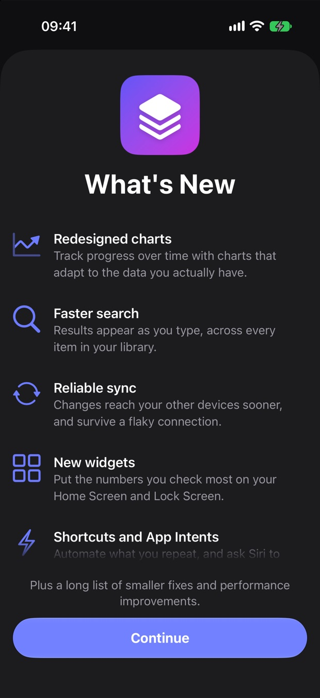
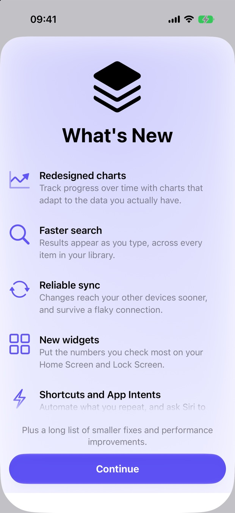
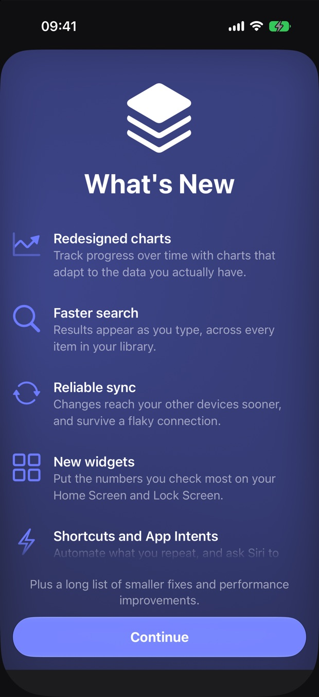
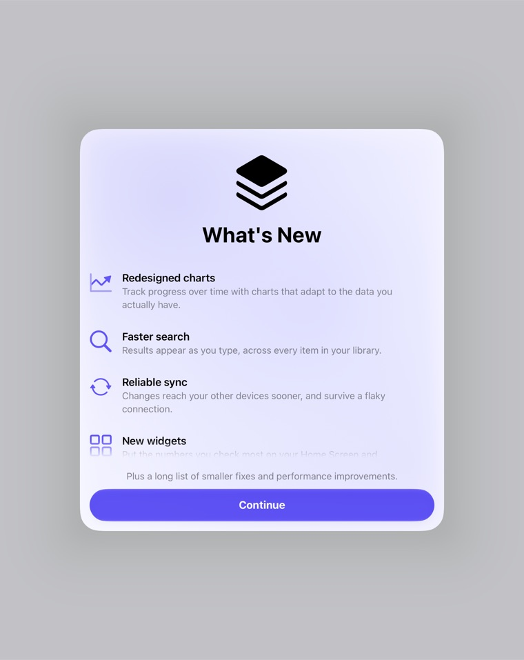
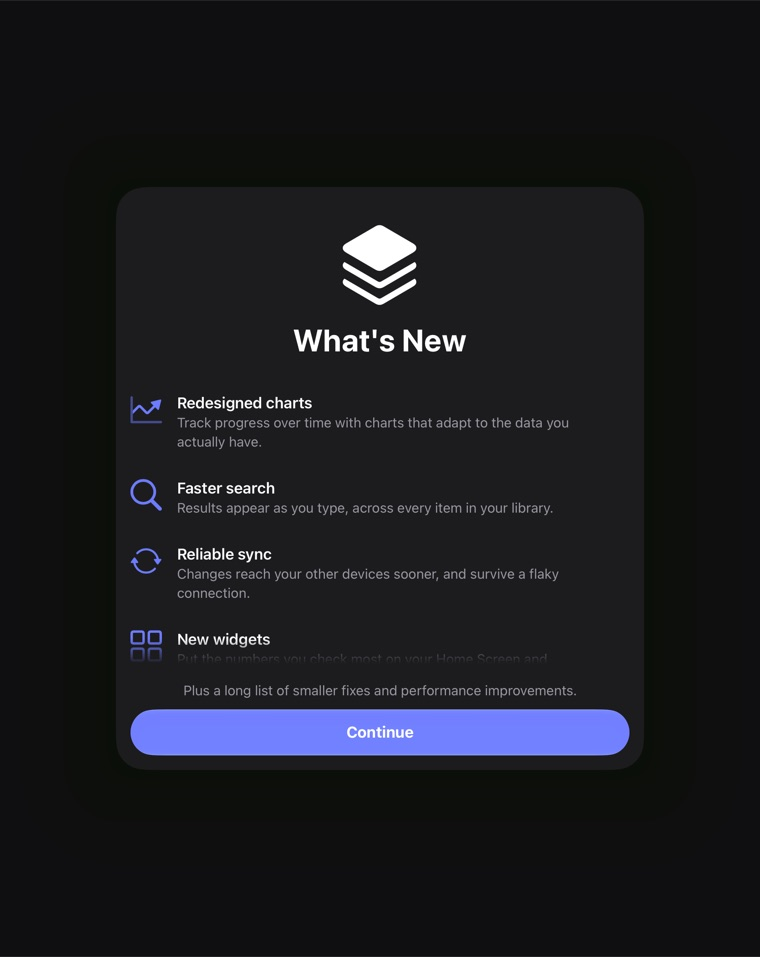
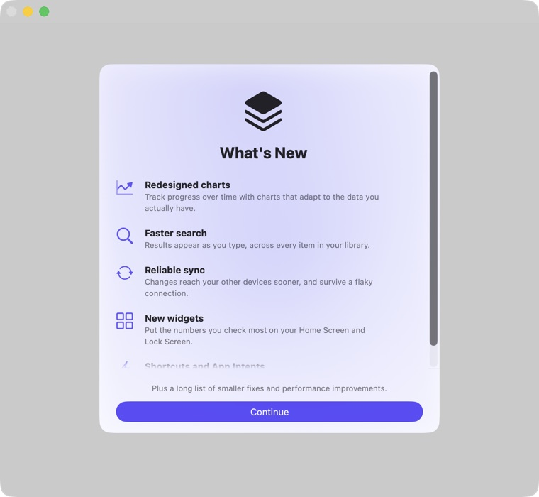
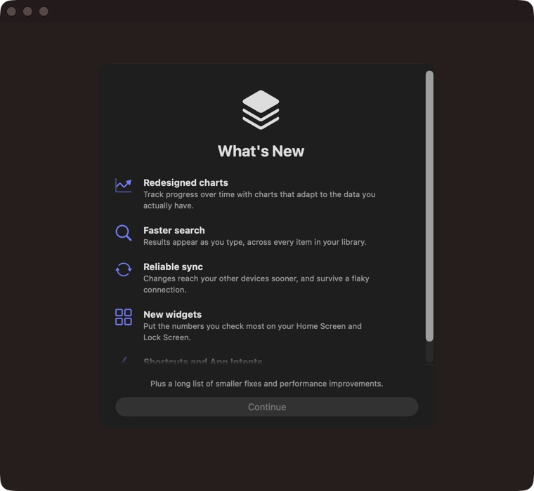

# ReleaseKit

[](https://github.com/hksw-io/ReleaseKit/actions/workflows/ci.yml)

A reusable SwiftUI "What's New" sheet for iOS and macOS apps in the HK Softworks portfolio.

The package and import name is `ReleaseKit`. Public view and content APIs intentionally use the
domain language `Release...`, for example `ReleaseView`, `ReleaseContent`, and
`ReleaseVersionTracker`.

## Preview

The default `.system` background on iPhone. Rows fade out where they meet the pinned footer, and the button spans it:

<p>
  
  
</p>

`.animatedGradient()`, taking its brand color from `ReleaseStyle.tint`. It adapts its tones per color scheme and holds still under Reduce Motion:

<p>
  
  
</p>

On iPad the same sheet presents as a centered card, sized to the content rather than the screen:

<p>
  
  
</p>

On macOS it is a resizable window with the platform's overlay scroller, and Escape runs `onDismiss`:

<p>
  
  
</p>

## Requirements

- iOS 26+ / macOS 26+
- Swift 6.2+

## Installation

```swift
.package(url: "https://github.com/hksw-io/ReleaseKit.git", from: "3.0.0")
```

Or in Xcode: **File > Add Package Dependencies** and enter the URL above.

## Usage

Implement `ReleaseContent` with your app's strings and icon, then present the view. Only `title`, `features`, and `buttonText` are required — `appIcon` and `notice` default to `nil`:

```swift
import SwiftUI
import ReleaseKit

struct MyRelease: ReleaseContent {
    var appIcon: Image? { Image("AppIconImage") }
    var title: Text { Text("What's New in MyApp") }
    var features: [ReleaseFeature] {
        [
            ReleaseFeature(
                id: "new-charts",
                systemImage: "chart.line.uptrend.xyaxis.circle",
                label: "New Charts",
                description: "Track your progress with redesigned charts."),
        ]
    }
    var notice: ReleaseNotice? {
        ReleaseNotice("Plus many other improvements.")
    }
    var buttonText: Text { Text("Continue") }
}

struct RootView: View {
    @State private var isShowing = false

    var body: some View {
        ContentView()
            .sheet(isPresented: $isShowing) {
                ReleaseView(content: MyRelease()) {
                    isShowing = false
                }
            }
    }
}
```

## Backgrounds

The default background is the system sheet surface. Use `releaseBackground(_:)` when an app needs a more branded release note experience:

```swift
ReleaseView(content: MyRelease()) {
    isShowing = false
}
.releaseBackground(.animatedGradient())
.releaseStyle(ReleaseStyle(tint: .indigo))
```

Built-in options:

- `.system` — the default platform background.
- `.softGradient` / `.softGradient(brand:palette:)` — a restrained brand-derived background tuned for readable content.
- `.animatedGradient(brand:palette:)` — an opt-in smooth full-surface animated gradient. It uses the style tint by default, adapts its tones for light and dark mode, and automatically becomes static when Reduce Motion is enabled.
- `.custom { context in ... }` — a fully custom SwiftUI background, including a plain `LinearGradient` of your own colors. Use `context.reduceMotion`, `context.brandColor`, and `context.colorScheme` to keep custom backgrounds consistent and accessible.

Every background spans behind the pinned footer and button area, including `.system`. macOS shows its normal overlay scroller, which is how a Mac signals that a list continues; iOS hides the indicator and lets the content fade out at the footer instead.

`ReleaseStyle.tint` is the default brand color for `.softGradient` and `.animatedGradient()`. The supporting tones are that same color washed toward the platform surface, so the field reads as one color family rather than as unrelated hues — and because the surface is light in light mode and dark in dark mode, the same wash lifts the palette in one and deepens it in the other.

Pass `brand:` when the background should use a different brand color from the controls, or pass a full palette when an app needs exact light and dark tones:

```swift
let palette = ReleaseGradientPalette(
    light: .init(
        base: .white,
        primary: .pink,
        secondary: .orange,
        accent: .yellow),
    dark: .init(
        base: .black,
        primary: .pink,
        secondary: .purple,
        accent: .cyan))

ReleaseView(content: MyRelease()) {
    isShowing = false
}
.releaseBackground(.animatedGradient(palette: palette))
```

The animated gradient's travel, speed, and contrast are fixed. Reduce Motion holds it still; there is no per-app intensity to set.

Reduce Transparency or Increase Contrast replaces either built-in gradient with the opaque
system surface. Custom backgrounds receive `context.reduceTransparency` and
`context.colorSchemeContrast` as well, so they can provide the same accessible treatment.

ReleaseKit keeps the footer pinned, sized to its own content. Rows fade out over a short band where they meet it, so the background carries through unbroken and a footer running to several lines never has content showing through it. The footer reserves no more space than it uses.

## Styling

Use `releaseStyle(_:)` to override foreground, tint, and button colors while keeping the library's layout, typography, and motion:

```swift
ReleaseView(content: MyRelease()) {
    isShowing = false
}
.releaseStyle(ReleaseStyle(
    tint: .indigo,
    titleColor: .primary,
    featureIconColor: .mint,
    featureDescriptionColor: .secondary,
    noticeColor: .secondary))
```

`ReleaseBackground` controls the surface behind the sheet content. `ReleaseStyle` controls foreground roles such as title, feature rows, notice text, and button text. Any color you leave as `nil` uses the standard system treatment. `tint` controls the prominent button accent and is also used by feature icons unless `featureIconColor` is set.

`buttonForegroundColor` is left out of the example on purpose. Its default is the system's prominent-button label color, which already adapts to your tint, to light and dark mode, and to Increase Contrast — setting it to a fixed color usually costs you contrast somewhere.

## Platform behavior

The sheet is one API with two deliberately different presentations. You do not configure this; it follows the platform.

| | iOS | macOS |
|---|---|---|
| Return | Activates the button | Activates the button |
| Escape | — (swipe-to-dismiss stays disabled) | Runs `onDismiss` |
| Scroll indicator | Hidden | Normal overlay scroller |
| Sheet size | Presenter's detents | 560×520 ideal, 480×420 floor |
| Reveal motion | 38pt travel | 20pt travel, leads sooner |

The footer button is a full-width prominent capsule on both platforms. The sheet is a single-action surface, so the button reads as the end of the content rather than as a Mac sheet's bottom-trailing default button. Both platforms use the system prominent button style, so press, hover, focus, and Increase Contrast behavior come from the platform rather than from anything this package draws.

Escape is bound to `onDismiss` rather than dismissing the sheet natively. That matters: a native dismissal would bypass your closure and skip whatever you do there — `ReleaseVersionTracker.markAsShown()`, typically — so the sheet would return on the next launch. Every exit runs `onDismiss`.

Text in the title and feature rows is selectable, which Mac users expect of a window they may want to copy out of.

## Features and localization

Every `ReleaseFeature` requires a stable `id`. Stable IDs let SwiftUI preserve row identity when features are inserted, removed, or reordered. Because conformers usually expose `features` as a computed property, an ID derived per evaluation — a fresh `UUID()`, say — would re-create every row on each pass and replay the entrance animation.

`ReleaseFeature` and `ReleaseNotice` each have a `Text` initializer and a `LocalizedStringResource` one. Localized values resolve against your app's bundle, so ReleaseKit ships no strings of its own and never localizes on your behalf. That is also why `buttonText` has no default.

The content types are `Equatable` and `Sendable`, and `ReleaseContent` refines `Sendable`.

## Version tracking

`ReleaseVersionTracker` persists the last-shown version in `UserDefaults` and decides whether to present the sheet on launch:

```swift
let tracker = ReleaseVersionTracker(
    keyPrefix: "com.example.myapp",
    currentVersion: "1.2.0")

if tracker.shouldShowRelease() {
    // present ReleaseView
}

// after dismiss:
tracker.markAsShown()
```

The first launch after install is treated as "not new" — users see the sheet only on subsequent version upgrades. `shouldShowRelease()` is not a pure query: on that first launch it writes both tracking keys before returning `false`. Every later call only reads.

Versions are compared for equality, not order, so `currentVersion` can be any string your app treats as its release identity. A rollback to an older version also shows the sheet.

`keyPrefix` namespaces the two keys the tracker writes, so trackers with different prefixes never observe each other's state.

The package bundles `PrivacyInfo.xcprivacy` for app-local (`CA92.1`) and same-App-Group
(`1C8F.1`) UserDefaults storage. Pass only your app's defaults or an entitled App Group suite,
and use an app-specific prefix. ReleaseKit does not collect data or perform tracking. Preserve
the Swift package resource bundle when embedding the library and verify the manifest in your archive.

For an informational sheet, allow native dismissal gestures and record acknowledgement from
the presentation's dismissal callback. The view's closure requests dismissal from its button
or the Mac Escape shortcut; it is not a notification for every way a presentation can close.

```swift
.sheet(isPresented: $isShowing, onDismiss: tracker.markAsShown) {
    ReleaseView(content: MyRelease(), allowsInteractiveDismissal: true) {
        isShowing = false
    }
}
```

The default remains `false` for source and behavior compatibility. Do not also mark the version
inside the button callback when using the presentation callback.

## Local development

Run the package tests from the package root:

```sh
swift test
```

Formatting is owned by `swift-format` against the checked-in `.swift-format`:

```sh
swift format --in-place --recursive Sources Tests
swift format lint --strict --recursive Sources Tests
```

Lint runs in CI, and every public declaration must carry a documentation comment.

## License

MIT. See [LICENSE](LICENSE).

## OS 27 compatibility

The deployment minimum remains iOS 26 / macOS 26, with Swift tools 6.2. CI runs package tests
on macOS and iOS Simulator with Xcode 26.6 and the Xcode 27.0 preview image. Each job selects
its toolchain and runtime generation explicitly; the 27 image is maintained by GitHub as
[`xcode-27`](https://github.com/actions/runner-images/issues/14404). New SDK-only APIs must
preserve the existing deployment and compiler minimums. Local SDK 27.2 validation complements
these jobs; a local pass does not establish the result of a hosted CI run.
